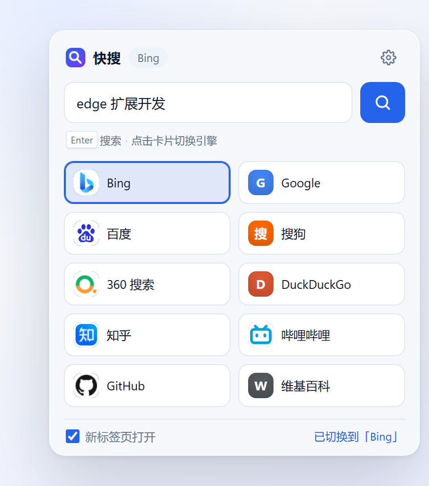
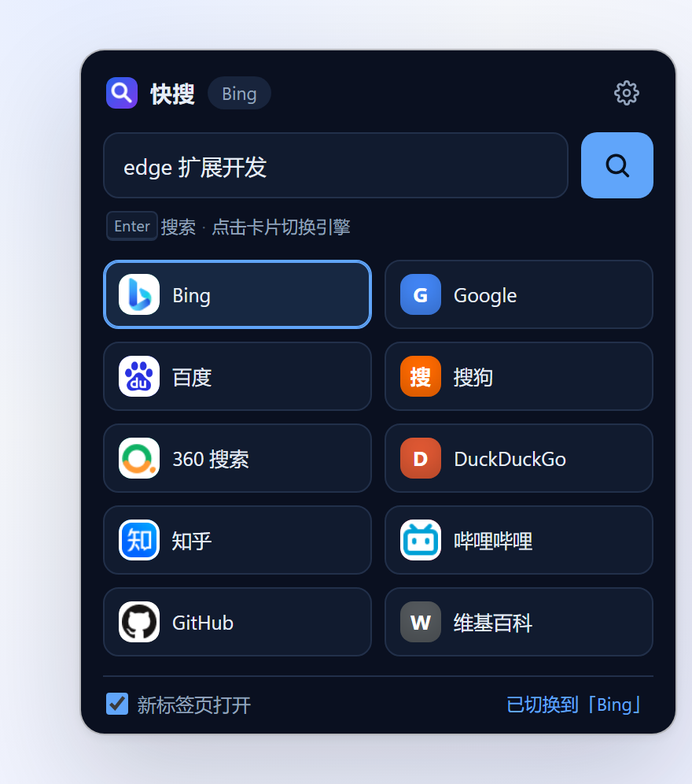

# 快搜 · 一键切换搜索引擎

一个给 Microsoft Edge（同样适用于 Chrome 等 Chromium 浏览器）用的搜索引擎切换扩展：**输入关键词 → 选一个引擎 → 回车**，不用再去地址栏里切默认搜索引擎。



<details>
<summary>深色模式</summary>



</details>

## 它能做什么

- **一个面板搜所有**：输入关键词按 `Enter` 用当前引擎搜索，结果按你的设置在新标签页或当前标签页打开。
- **点击即切换**：点引擎卡片切换默认引擎；搜索框里有内容时点卡片，会用新引擎立刻重新搜索。
- **右键搜索选中文本**：选中文字后右键 →「用「Bing」搜索」，展开菜单还能临时换成任意引擎。
- **自动抓取官方图标**：优先用浏览器内置的官方图标接口（`_favicon`，取站点在 `<link rel="icon">` 里声明的正式图标并走本地缓存），取不到再退回站点 `/favicon.ico`，最后才是彩色字母徽标；也可以自己填图标地址。
- **完全自定义**：名称、搜索地址、图标、徽标文字、颜色、启用状态都能改，支持拖动排序与导入导出。
- **省事的细节**：自动填入页面中选中的文本、跟随系统深浅色、配置走浏览器同步存储、安装后打开一页图文引导。
- **不做多余的事**：不收集数据、不申请任何网站的访问权限；图标由浏览器自己的 favicon 缓存提供，扩展本身不抓网页内容。

## 安装（Edge，约 30 秒）

1. 打开 `edge://extensions`；
2. 打开左下角（或右侧栏）的 **开发人员模式**；
3. 点击 **加载解压缩的扩展**，选择本仓库的 `quick-search-extension` 文件夹（用 zip 的话先解压）；
4. 在工具栏的扩展菜单里把「快搜」**固定**，之后点图标打开。

> 首次安装会自动打开一页使用引导。

## 使用

| 操作 | 效果 |
| --- | --- |
| 点扩展图标 | 打开搜索面板，输入框自动聚焦 |
| 输入关键词 + `Enter` | 用当前引擎搜索 |
| 点击引擎卡片 | 切换默认引擎；若已输入关键词则立即搜索 |
| 右上角齿轮 | 打开设置页 |
| 选中文字后右键 | 「用「Bing」搜索」；展开子菜单可换任意引擎 |
| 面板底部复选框 | 切换「新标签页 / 当前标签页」打开 |

面板里的引擎顺序与设置页一致，点卡片即可换引擎；这个版本没有注册任何键盘快捷键，也不需要记组合键。

## 自定义搜索引擎

设置页 →「添加引擎」，搜索地址里用 `%s` 表示关键词的位置：

```
https://www.google.com/search?q=%s
https://search.bilibili.com/all?keyword=%s
https://github.com/search?q=%s&type=repositories
https://www.zhihu.com/search?type=content&q=%s
```

- 地址必须以 `http://` 或 `https://` 开头，并且包含 `%s`，否则保存时会被拦下；旧配置里的 `{q}` 导入后会自动转成 `%s`。
- **图标**默认留空，会自动读取官方图标：先用浏览器 favicon 接口（站点声明的正式图标），失败再退回 `https://<站点>/favicon.ico`。想固定用某个图标时，在「图标地址」里填图片 URL，右侧会实时预览。
- 徽标文字最多 3 个字符，留空会按名称自动生成（中文取首字、英文取首字母、数字取前几位），同时也是图标加载失败时的兜底样式。
- 拖动行左侧的 `⠿` 手柄可以排序（也可以用 `↑`/`↓` 按钮），面板里的卡片顺序就是这里的顺序。
- 「默认」标记的引擎是面板默认选中项，也是右键菜单主项使用的引擎。

## 项目结构

```
quick-search-extension/
├─ manifest.json          # Manifest V3 清单
├─ icons/                 # 16/32/48/128 PNG + SVG 源文件
├─ src/
│  ├─ common.js           # 纯函数 + chrome.storage 封装（可单测）
│  ├─ ui.js               # 引擎图标：官方图标接口 + /favicon.ico + 字母兜底
│  ├─ background.js       # Service worker：右键菜单、安装引导、配置变更刷新
│  ├─ popup.html/.css/.js # 搜索面板
│  ├─ options.html/.css/.js # 设置页
│  ├─ welcome.html/.js    # 安装后的引导页
│  └─ base.css            # 两页共用的设计变量与组件
├─ tests/
│  ├─ common.test.mjs     # 23 个单元测试（URL、官方图标来源、配置收敛、导入导出、排序）
│  └─ popup.smoke.mjs     # 面板冒烟测试（DOM 桩，跑通搜索/切换/图标流程）
├─ tools/
│  ├─ check-extension.mjs # 打包自检：清单引用、资源路径、元素 id
│  ├─ make_icons.py       # 图标生成脚本
│  └─ preview.html        # README 截图用的静态预览页
└─ docs/                  # 界面截图与图标尺寸对照
```

## 开发与测试

无需构建，改完源码在 `edge://extensions` 里点一下「重新加载」即可。

```powershell
npm test            # 单元测试 + 面板冒烟测试
npm run check       # 清单 / 资源 / 元素 id 自检
npm run icons       # 重新生成图标（Pillow）
```

`tools/preview.html` 是生成 README 截图用的静态预览页，不参与扩展运行。

## 权限说明

| 权限 | 为什么需要 |
| --- | --- |
| `storage` | 保存引擎列表与设置（`storage.sync`，可随账户同步） |
| `contextMenus` | 选中文字后的右键搜索菜单 |
| `scripting` + `activeTab` | 仅在你打开面板时，读取当前页面**选中的文字**填入搜索框；不注入常驻脚本 |
| `favicon` | 调用浏览器内置的官方图标接口（`_favicon`），拿到站点声明的正式图标 |
| `<all_urls>` 等主机权限 | **未申请**。扩展不读取、不修改任何网页内容 |

> 官方图标直接由浏览器的 favicon 缓存提供（`_favicon` 接口），扩展代码本身不抓网页、不注入脚本；`favicon` 权限可能让浏览器在安装时多提示一句，属于正常现象。

## 隐私

扩展只在本地拼装搜索 URL 并交给浏览器打开，没有统计或遥测，也不会上传配置。图标相关行为：

1. 官方图标走 `chrome-extension://<id>/_favicon/`，由浏览器从它自己的 favicon 缓存返回（必要时由浏览器去获取，扩展不参与）；
2. 官方图标取不到时，退回站点的 `/favicon.ico` 直接加载；
3. 设置里关掉「显示搜索引擎图标」后，以上两类都不再发生。

所有配置都保存在本地 `storage.sync` 中，导出的 JSON 也只落在你自己的磁盘上。

## 常见问题

**怎么打开面板？**
点工具栏上的「快搜」图标。这个版本不注册键盘快捷键，所以没有 `Alt`+`S` 之类的全局按键。

**图标显示成字母？**
说明官方图标和站点的 `/favicon.ico` 都没取到（站点没有声明图标、浏览器缓存里也没有、或网络不通）。可以在设置页给这个引擎填一个图标地址，或保持字母徽标——两种都是正常状态。

**右键菜单里为什么只有部分引擎？**
菜单只列出「已启用」的引擎；在设置页把开关打开即可。

**换电脑后配置会同步吗？**
使用同一个 Edge 账户并开启同步时会跟随同步；也可以导出 JSON 手动迁移。

**旧配置里的 `{q}` 还能用吗？**
能。导入时会自动转换成 `%s`，搜索行为不变。

**为什么搜狗、360 搜的是网页而不是「问问」之类？**
默认模板选的是各家通用网页搜索，你可以在设置里把地址换成任意结果页模板。

## 说明

- 名称「快搜」、图标与默认引擎列表都可自行修改；默认引擎模板可能随各家站点改版而变化，失效时在设置页更新地址即可。
- 这是一个纯前端扩展，不依赖任何第三方库或远程代码。
